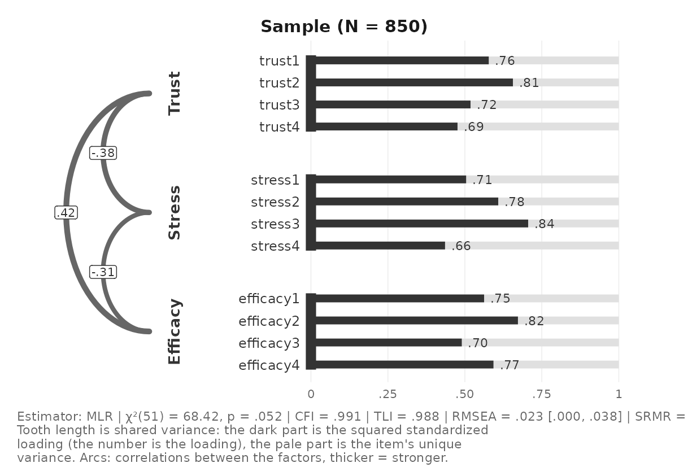

# psyWiz

A **jamovi module** and R package for confirmatory factor analysis and structural equation modeling, built on [lavaan](https://lavaan.ugent.be).

psyWiz bridges critical gaps in standard psychometric software: it offers native ordinal item treatment (WLSMV), automated measurement invariance with guided verdicts and latent mean comparisons, side-by-side multi-estimator evaluation, ESEM with target rotation, and **three novel, mathematically grounded visualizations** where bar lengths represent actual variance proportions.

You simply drag items into factor boxes—no complex model syntax to write.

---

## Novel Visualizations: Visual Psychometrics

psyWiz replaces uninformative, tangled "spaghetti" path diagrams with three novel plots designed to make psychometric properties intuitive at a glance. Every plot operates on a standardized $0 \text{ to } 1$ variance metric and supports printing the complete model fit line with the estimator (positioned either below or above).

See [docs/PLOTS.md](docs/PLOTS.md) for the complete visual guide.

| Visualization | What it Shows | Example |
|---|---|---|
| **Comb Plot** | True variance decomposition per item (dark teeth = $\lambda^2$, pale remainder = uniqueness), factor correlation arches, residual covariance brackets, and higher-order anchor spines. |  |
| **Antenna Plot** | Bifactor variance allocation per item: left dark bar = general factor ($\lambda_g^2$), right grey bar = specific subscale factor ($\lambda_s^2$). Shows immediately whether the construct is general-dominated or specific-dominated. |  |
| **Brush Plot** | ESEM target vs. cross-loadings visualized as a toothbrush: dark bristles = target loadings, grey bristles = cross-loadings ($\ge .10$), right column = uniqueness. |  |

---

## Core Suite (First Release)

The first release focuses strictly on the complete **CFA + ESEM** universe:

| Analysis | Default Output | Key Differentiators & Advanced Capabilities |
|---|---|---|
| **CFA** | Fit indices, standardized loadings, factor correlations, $\alpha$, $\omega$, AVE, and Comb Plot | Residual covariances freed; second-order hierarchical factor; path diagram; factor correlations under multiple scoring methods; largest modification indices; optional model fit on plot with estimator. |
| **Group CFA (Invariance)** | Invariance ladder across groups (Configural $\rightarrow$ Metric $\rightarrow$ Scalar $\rightarrow$ Strict) with clear guided verdicts per step | Score tests for worst-fitting constraints; automated partial invariance search; multiverse sensitivity analysis; **Latent Mean Comparisons** across groups with forest plots, Wald tests, Delta-method SEs, and Latent Cohen's $d$ (reference & pooled). |
| **Bifactor CFA** | General vs. specific factors: fit comparison against correlated factors, hierarchical omega ($\omega_H$), total omega ($\omega$), ECV, Item ECV | **Antenna Plot** and **Facing Combs** showing item-by-item variance partition between general and subscale dimensions; bifactor path diagram. |
| **Multi-Estimator CFA** | Side-by-side comparison of a single model across up to 8 estimators | Evaluates model robustness across ML, MLR, MLM, WLS, WLSMV, ULS, ULSMV, and DWLS; highlights parameter stability or estimator sensitivity. |
| **CFA vs ESEM** | Direct comparison of CFA against Exploratory SEM with target rotation | Ladder $\chi^2$ difference tests (with uncorrected vs. scaled handling); factor correlations across 5 scoring methods; **Brush Plot** diagnosing item cross-loadings. |

*(Note: Scale analysis tools including Guttman Scalograms, Hasse item order diagrams, and composite checks are reserved for subsequent releases. See [docs/ROADMAP.md](docs/ROADMAP.md).)*

---

## Why psyWiz? (Differentiators)

1. **No Spaghetti Diagrams:** Comb, Antenna, and Brush plots display exact variance shares on a $0 - 1$ metric rather than arbitrary coordinates.
2. **Model Fit on Plots:** Dynamically prints `Estimator: [Name] | χ²(df) = ..., p = ... | CFI = ... | RMSEA = ... [90% CI] | SRMR = ...` above or below figures.
3. **Native Ordinal Treatment:** Automatically selects WLSMV and polychoric correlations based on jamovi measure types, with delta and theta parameterization.
4. **Actionable Invariance Verdicts:** Replaces manual table subtraction with automated step-by-step verdicts, culprit constraint discovery, and partial invariance modeling.
5. **Latent Mean Comparisons:** Provides rigorous group mean comparisons once scalar invariance holds, complete with forest comparison plots and latent effect sizes.
6. **Robustness-First Psychometrics:** Built-in multiverse analysis tests whether findings hold across different estimators, cutoffs, and decision rules.

---

## Installation

### In jamovi
Until available directly in the jamovi library store:
1. Download or build `psyWiz_0.4.0.jmo` (see [docs/DEVELOPING.md](docs/DEVELOPING.md)).
2. Sideload via jamovi menu: **Modules $\rightarrow$ Sideload**.
3. The sample dataset *Trust and stress in three countries* will appear in your Data Library.

### In R
```r
# install.packages("remotes")
remotes::install_github("heelgueta/psywiz")
library(psyWiz)
data(wizdata)

# Specify factors
model <- list(Trust  = paste0("trust", 1:4),
              Stress = paste0("stress", 1:4))

# 1. Plain CFA with comb plot and fit line
cfa <- factorWiz(wizdata, model)
plot(cfa, type = "comb", fit = "below")

# 2. Measurement Invariance across countries
inv <- invarianceWiz(wizdata, model, group = "country")
inv

# 3. Latent Mean Comparisons across groups
means <- invarianceMeans(inv)
plot(means)

# 4. Bifactor CFA with antenna plot
bf <- bifactorWiz(wizdata, model, general = "Distress")
plot(bf, type = "antenna", fit = "below")

# 5. ESEM with brush plot
esem <- esemWiz(wizdata, model)
plot(esem, type = "brush", fit = "below")
```

---

## Documentation

- [docs/PLOTS.md](docs/PLOTS.md): In-depth guide and gallery of the Comb, Antenna, and Brush plots.
- [NEWS.md](NEWS.md): Release notes and changelog.
- [docs/METHODS.md](docs/METHODS.md): Mathematical formulations, estimators, cutoffs, and references.
- [docs/ROADMAP.md](docs/ROADMAP.md): Project roadmap and future releases.
- [docs/DATA.md](docs/DATA.md): Guide to example datasets (`wizdata`, `wizlab`).
- [docs/DESIGN.md](docs/DESIGN.md): Architectural design of the engine and jamovi bindings.

---

## Licence

GPL-3. See [LICENSE](LICENSE).
