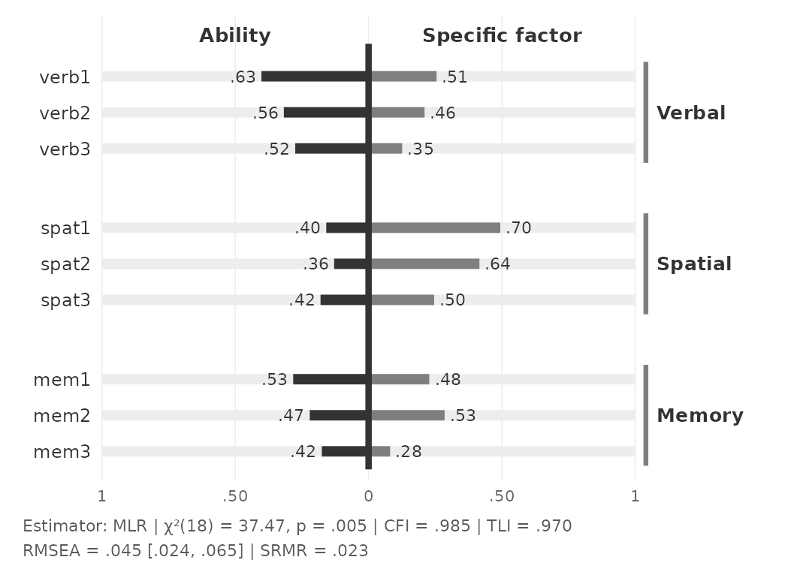
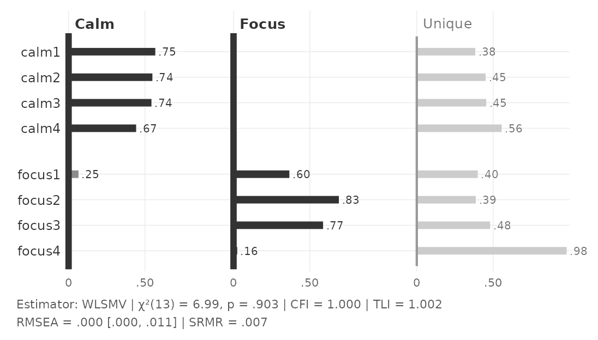

# psyWiz

A **jamovi module** and R package for scale evaluation, confirmatory factor analysis, measurement invariance, and ESEM, built on [lavaan](https://lavaan.ugent.be).

psyWiz fills practical gaps in standard psychometric software: native ordinal item handling (WLSMV), step-by-step measurement invariance with guided verdicts and latent mean comparisons, pure bifactor modeling, target-rotated ESEM, side-by-side multi-estimator sensitivity checks, and **three novel greyscale visualizations** where bar lengths represent exact variance proportions.

You drag items into factor boxes — no model syntax to write.

---

## Visual Psychometrics

psyWiz replaces arbitrary "spaghetti" path diagrams with three purpose-built greyscale figures on a $0 \text{ to } 1$ variance scale. Figures stay clean for publication (no instructional clutter baked into the image), pair with a toggleable reading guide above each plot in jamovi, and optionally print the model fit line with the estimator (`above` or `below`).

See [docs/PLOTS.md](docs/PLOTS.md) for the full visual gallery and examples on realistic imperfect data.

| Visualization | What it Shows | Example |
|---|---|---|
| **Comb Plot** | Variance decomposition per item (dark tooth = $\lambda^2$, pale remainder = unique variance), factor correlation arches, residual brackets, and second-order anchor spines. |  |
| **Antenna Plot** | Bifactor variance allocation per item: dark left bar = general factor ($\lambda_g^2$), grey right bar = specific factor ($\lambda_s^2$). Immediately separates general- from specific-dominated facets. |  |
| **Brush Plot** | ESEM target vs. cross-loadings visualized as a toothbrush: dark bristles = intended factor, grey bristles = cross-loadings ($\ge .10$), rightmost column = unique variance. |  |

---

## The Menu (6 Analyses)

Ordered from checking a single scale to multi-factor, multi-group, and sensitivity workflows:

| Analysis | Default Output | Optional Extensions |
|---|---|---|
| **Scale Check** | Reliability ($\alpha$, $\lambda_2$, $\omega$, AVE), item diagnostics, and Comb Plot | Tau-equivalence & parallelism tests; Guttman / Mokken scalability ($H$, CR, CS) and scalogram; path diagram |
| **CFA** | Fit indices, standardized loadings, factor correlations, reliability ($\alpha$, $\omega$, AVE), and Comb Plot | Second-order factor; freed residual correlations; modification indices; factor correlations by scoring method; path diagram |
| **Measurement Invariance** | Multi-group CFA ladder (Configural $\rightarrow$ [Thresholds] $\rightarrow$ Metric $\rightarrow$ Scalar) with verdicts & worst-fitting constraints | Strict invariance; automated partial invariance search; **Latent Mean Comparisons** (Wald tests, Delta-method SEs, Latent Cohen's $d$, forest plot); multiverse robustness check; group loadings & configural plots |
| **Bifactor CFA** | Bifactor vs. correlated-factors fit, $\omega$, $\omega_H$, ECV, Item ECV, standardized loadings, and Antenna Plot | Facing Combs; bifactor path diagram |
| **CFA vs. ESEM** | CFA vs. target-rotated ESEM fit and $\Delta\chi^2$ comparison, full loadings & cross-loadings, factor correlations across 5 scoring methods, and Brush Plot | Geomin rotation |
| **Multi-Estimator CFA** | One CFA fitted side by side across up to 8 estimators (ML, MLR, MLM, ULS, ULSMV, DWLS, WLSMV, WLS) | Unstandardized loadings, sorting by loading |

Every analysis shares the same clean options layout (`Estimation` $\rightarrow$ analysis extensions $\rightarrow$ `Tables` $\rightarrow$ `Plots`), runs only when **Run analysis** is ticked so jamovi never freezes while dragging items, and offers an optional **Flag weak / misfitting values** toggle (off by default) that marks weak loadings, cross-loadings, and poor fit indices in red directly inside the tables.

---

## Installation

### In jamovi
Until available directly in the jamovi library:
1. Download or build `psyWiz_1.0.0.jmo` (see [docs/DEVELOPING.md](docs/DEVELOPING.md)).
2. Sideload via jamovi menu: **Modules $\rightarrow$ Sideload**.
3. Two example datasets (*Trust and stress in three countries* and *A laboratory of instruments*) appear in **Open $\rightarrow$ Data Library $\rightarrow$ psyWiz**.

### In R
```r
# install.packages("remotes")
remotes::install_github("heelgueta/psywiz")
library(psyWiz)
data(wizdata)

model <- list(Trust  = paste0("trust", 1:4),
              Stress = paste0("stress", 1:4))

# 1. Single-scale check
sc <- scaleWiz(wizdata, paste0("trust", 1:4), name = "Trust")
plot(sc, type = "comb", fit = "below")

# 2. CFA with comb plot and model fit line
cfa <- factorWiz(wizdata, model)
plot(cfa, type = "comb", fit = "below")

# 3. Measurement invariance & latent means across countries
inv <- invarianceWiz(wizdata, model, group = "country")
part <- invariancePartial(inv)
means <- invarianceMeans(part)
plot(means)

# 4. Bifactor CFA with antenna plot
data(wizlab)
bf <- bifactorWiz(wizlab, list(Body = paste0("body", 1:4),
                               Mind = paste0("mind", 1:4),
                               Social = paste0("social", 1:4)),
                  general = "Wellbeing")
plot(bf, type = "antenna", fit = "below")

# 5. CFA vs. ESEM with brush plot
esem <- esemWiz(wizlab, list(Calm = paste0("calm", 1:4),
                             Focus = paste0("focus", 1:4)))
plot(esem, type = "brush", fit = "below")
```

---

## Documentation

- [docs/PLOTS.md](docs/PLOTS.md): Visual gallery and reading guide for the Comb, Antenna, and Brush plots.
- [NEWS.md](NEWS.md): Changelog.
- [docs/METHODS.md](docs/METHODS.md): Statistical methods, estimators, cutoffs, and references.
- [docs/DATA.md](docs/DATA.md): Guide to the built-in example datasets (`wizdata`, `wizlab`).
- [docs/ROADMAP.md](docs/ROADMAP.md): Project status and future work.
- [docs/DESIGN.md](docs/DESIGN.md): Architecture of the engine and jamovi layer.

---

## Licence

GPL-3. See [LICENSE](LICENSE).
