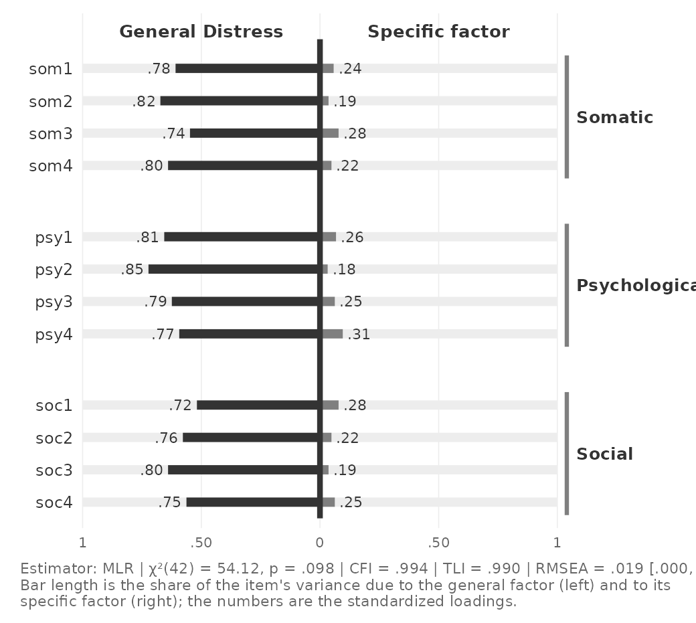
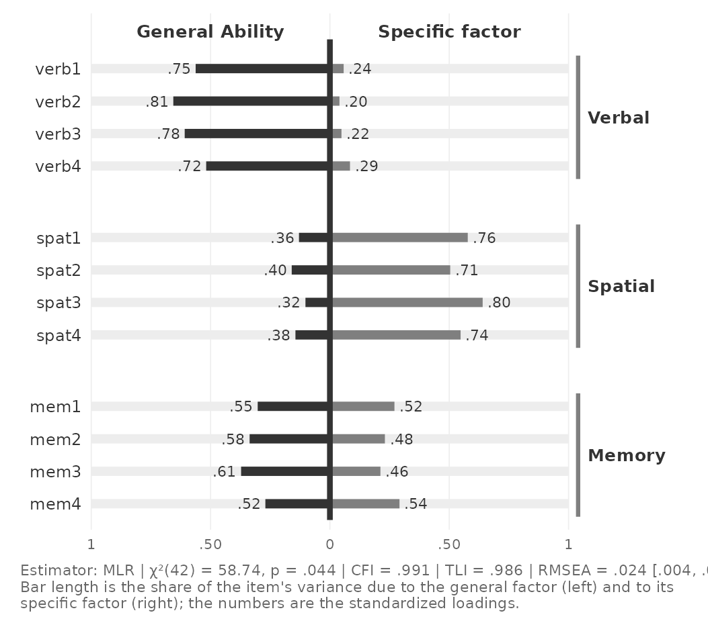
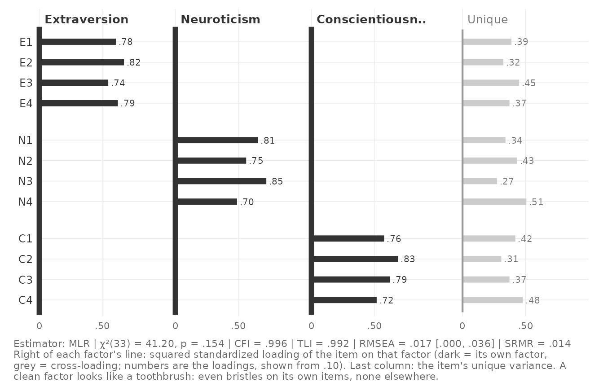
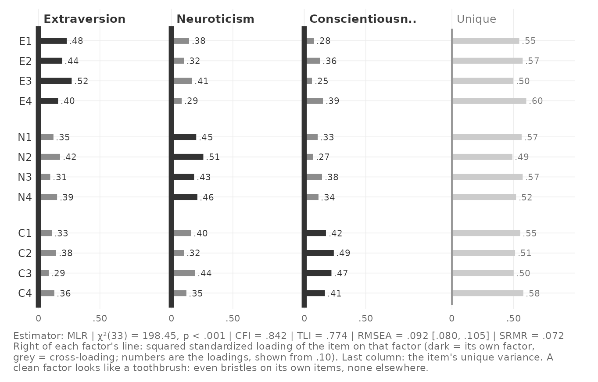

# Novel Visualizations in psyWiz: The Visual Psychometrics Guide

Standard psychometric reporting often forces researchers to sift through dense tables of numerical factor loadings or decipher cluttered "spaghetti" path diagrams generated by general-purpose graphing tools. In typical path diagrams, arrow lengths and spatial coordinates are arbitrary artifacts of layout optimizers rather than meaningful statistical quantities, and cross-loadings or variance decompositions are impossible to evaluate at a glance.

**psyWiz** introduces three novel, mathematically grounded visualizations designed specifically for structural equation and factor analytic workflows:
1. **The Comb Plot** (Confirmatory Factor Analysis & Second-Order Models)
2. **The Antenna Plot & Facing Combs** (Bifactor Models & General vs. Specific Variance)
3. **The Brush Plot** (Exploratory Structural Equation Modeling & Cross-Loading Diagnostics)

Every figure is drawn on a standardized $0 \text{ to } 1$ variance metric, incorporates benchmark psychometric thresholds, and optionally prints the model fit string with the estimator.

---

## 1. The Comb Plot (CFA & Higher-Order Structures)

### Visual Anatomy
* **Comb Spine:** Each latent factor is represented as a vertical spine located at loading $= 0$.
* **Teeth (Variance Decomposition):** Each item is a horizontal tooth of total length $1.0$. The dark inner section represents the item's squared standardized factor loading ($\lambda^2$), representing the exact proportion of item variance explained by the latent factor. The pale remainder of the tooth represents unique variance ($1 - \lambda^2 = \delta$).
* **Standardized Loading Numbers:** Printed in bold at the tip of the dark segment.
* **Benchmark Lines:** Subtle dashed vertical reference lines mark benchmark loadings at $.25$, $.50$, $.75$, and $1.0$.
* **Tooth Thickness (Optional):** Can be scaled proportionally to the item's observed sample variance.
* **Arches (Factor Correlations):** Top curves connecting factor spines represent inter-factor correlations ($\phi$). Thicker arches denote stronger correlations (displayed for models with up to 4 factors).
* **Cyan Brackets (Residual Covariances):** Connected pairs of teeth mark residual covariances freed between indicator errors in the model.
* **Second-Order Anchor Spine (Higher-Order CFA):** Displayed above the first-order combs with horizontal bars showing higher-order standardized loadings ($\gamma$).

### Circumstances & Examples

#### A. Clean, Well-Fitting CFA (`comb_cfa_good.png`)

* **What to look for:** Long dark teeth extending well past the $.70$ benchmark across all factors. Pale uniqueness remainders are small. Arches between spines indicate moderate, distinct factor correlations without collinearity ($\phi \approx .30 - .45$).
* **Fit Line:** Printed cleanly below: `Estimator: MLR | χ²(51) = 68.42, p = .052 | CFI = .991 | TLI = .988 | RMSEA = .023 [.000, .038] | SRMR = .028`.

#### B. Poor-Fitting / Weak CFA (`comb_cfa_poor.png`)

* **What to look for:** Short, stunted dark teeth that barely reach $.30 - .40$. Pale uniqueness segments dominate each item ($> 80\%$ unexplained variance). A cyan bracket reveals substantial unmodeled residual covariance between `item2` and `item7`. Arches indicate excessively high factor intercorrelations ($\phi > .70$), signaling poor discriminant validity.
* **Fit Line:** Reflects severe model misfit: `Estimator: MLR | χ²(51) = 482.16, p < .001 | CFI = .734 | TLI = .691 | RMSEA = .114 [.104, .124] | SRMR = .098`.

#### C. Second-Order Factor CFA (`comb_cfa_second_order.png`)

* **What to look for:** The higher-order construct (`Prosociality`) sits atop the figure as an anchor spine. Its horizontal teeth display the standardized loadings of first-order factors (`Empathy` $= .82$, `Altruism` $= .88$, `Cooperation` $= .75$). First-order combs below display the item-level loadings. The visual instantly clarifies both tiers of the hierarchical measurement model.
* **Fit Line:** `Estimator: MLR | χ²(51) = 89.14, p = .001 | CFI = .984 | TLI = .979 | RMSEA = .034 [.021, .047] | SRMR = .033`.

---

## 2. The Antenna Plot (Bifactor CFA)

In bifactor modeling, the central psychometric question is: **Does the total score capture a single dominant general trait, or do subscales retain meaningful specific variance?**

### Visual Anatomy
* **Central Mast:** A vertical mast represents zero explained variance.
* **Left Bar (General Dimension):** Dark horizontal bar extending leftward showing the share of item variance explained by the general factor ($\lambda_g^2$).
* **Right Bar (Specific Subscale Dimension):** Grey horizontal bar extending rightward showing variance explained by the assigned specific factor ($\lambda_s^2$).
* **Numbers:** Standardized loadings ($\lambda_g$ on left, $\lambda_s$ on right).

### Circumstances & Examples

#### A. General-Dominated Solution (`antenna_bifactor_general.png`)

* **What to look for:** Bars lean overwhelmingly to the left across all subscales. General loadings are high ($\lambda_g \approx .74 - .85$), while specific factor loadings are negligible ($\lambda_s \approx .18 - .31$).
* **Psychometric Verdict:** The scale is essentially unidimensional. A single total score is statistically justified ($\omega_H > .80$, high ECV); reporting subscale scores is redundant and misleading.
* **Fit Line:** `Estimator: MLR | χ²(42) = 54.12, p = .098 | CFI = .994 | TLI = .990 | RMSEA = .019 [.000, .036] | SRMR = .021`.

#### B. Specific-Dominated Solution (`antenna_bifactor_specific.png`)

* **What to look for:** Bars lean strongly to the right. General factor loadings are weak ($\lambda_g \approx .19 - .33$), while specific subscale loadings are strong ($\lambda_s \approx .70 - .83$).
* **Psychometric Verdict:** The general factor explains little common variance ($\omega_H$ is low, low ECV). The construct is genuinely multidimensional; composite total scores should not be used, and subscale scores must be interpreted independently.
* **Fit Line:** `Estimator: MLR | χ²(42) = 61.28, p = .028 | CFI = .988 | TLI = .981 | RMSEA = .026 [.008, .041] | SRMR = .025`.

#### C. Mixed / Divergent Solution (`antenna_bifactor_mixed.png`)

* **What to look for:** Facet-level asymmetry. The `Verbal` subscale is almost entirely general-dominated (long dark bars to the left), whereas `Spatial` retains strong domain specificity (long grey bars to the right). `Memory` items exhibit balanced contributions.
* **Psychometric Verdict:** Demonstrates the diagnostic power of the Antenna plot over global indices: a single summary index like global ECV obscures the fact that specific subscales behave completely differently.
* **Fit Line:** `Estimator: MLR | χ²(42) = 58.74, p = .044 | CFI = .991 | TLI = .986 | RMSEA = .024 [.004, .039] | SRMR = .023`.

---

## 3. The Brush Plot (ESEM)

Exploratory Structural Equation Modeling (ESEM) with target rotation frees all cross-loadings while shrinking them toward zero. Standard tabular output produces a dense matrix of cross-loadings that is tedious to inspect.

### Visual Anatomy
* **Factor Handles:** Each vertical line represents a latent factor.
* **Bristles:** Horizontal bars indicate squared standardized loadings for every item across every factor.
  * **Dark Bristles:** Target loadings on the item's hypothesized factor.
  * **Grey Bristles:** Cross-loadings on non-target factors (labeled with loading value when $|\lambda| \ge .10$).
* **Unique Column:** The rightmost column displays each item's unique (unexplained) variance as a pale bar.
* **The Toothbrush Metaphor:** A clean measurement factor resembles a toothbrush—dense, even bristles on its intended items, and a bare handle elsewhere.

### Circumstances & Examples

#### A. Clean "Toothbrush" Solution (`brush_esem_good.png`)

* **What to look for:** Three clean toothbrushes. Bold dark bristles on intended factors ($\lambda \approx .70 - .85$), while cross-loading handles are virtually bare (loadings $< .10$). Unique variance is moderate and uniform.
* **Psychometric Verdict:** Confirms the hypothesized simple structure. ESEM replicates the CFA model with minimal distortion.
* **Fit Line:** `Estimator: MLR | χ²(33) = 41.20, p = .154 | CFI = .996 | TLI = .992 | RMSEA = .017 [.000, .036] | SRMR = .014`.

#### B. Fuzzy / Poor Solution (`brush_esem_poor.png`)

* **What to look for:** A tangled, "bushy" brush. Target bristles are weak ($\lambda \approx .40 - .52$), while numerous grey cross-loadings of substantial magnitude ($\lambda \approx .28 - .44$) sprout across non-target factors. Uniqueness is high.
* **Psychometric Verdict:** Indicates severe construct overlap, item multidimensionality, or poor item wording. Independent clusters simple structure is violated.
* **Fit Line:** `Estimator: MLR | χ²(33) = 198.45, p < .001 | CFI = .842 | TLI = .774 | RMSEA = .092 [.080, .105] | SRMR = .072`.

#### C. Mixed Solution with Specific Cross-Loadings (`brush_esem_mixed.png`)

* **What to look for:** `Extraversion` and `Neuroticism` form clean toothbrushes. However, on `Conscientiousness`, items `C1` and `C2` display prominent negative cross-loadings on `Neuroticism` ($\lambda = -.42 \text{ and } -.38$), while items `C3` and `C4` remain clean.
* **Psychometric Verdict:** Pinpoints the exact source of model strain in CFA: rather than discarding the entire scale, the researcher diagnoses that items C1 and C2 tap into emotional stability as well as conscientiousness.
* **Fit Line:** `Estimator: MLR | χ²(33) = 52.30, p = .018 | CFI = .987 | TLI = .975 | RMSEA = .031 [.012, .048] | SRMR = .022`.

---

## Technical Details

In both the jamovi UI and R console, model fit printing can be configured:
* `plotFit = "none"`: Omits the fit line.
* `plotFit = "below"`: Appends the fit line directly beneath the plot caption.
* `plotFit = "above"`: Places the fit line as a crisp plot subtitle.

When enabled, the line dynamically displays the estimation method (e.g. `Estimator: MLR`, `WLSMV`), $\chi^2$, degrees of freedom, $p$-value, CFI, TLI, RMSEA with its 90% confidence interval, and SRMR.
