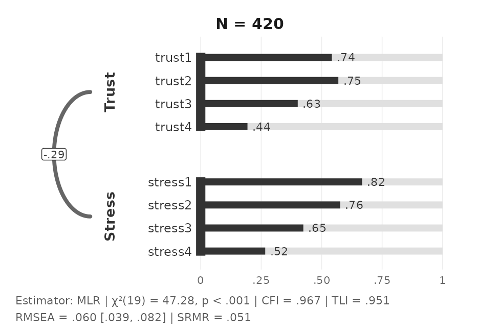
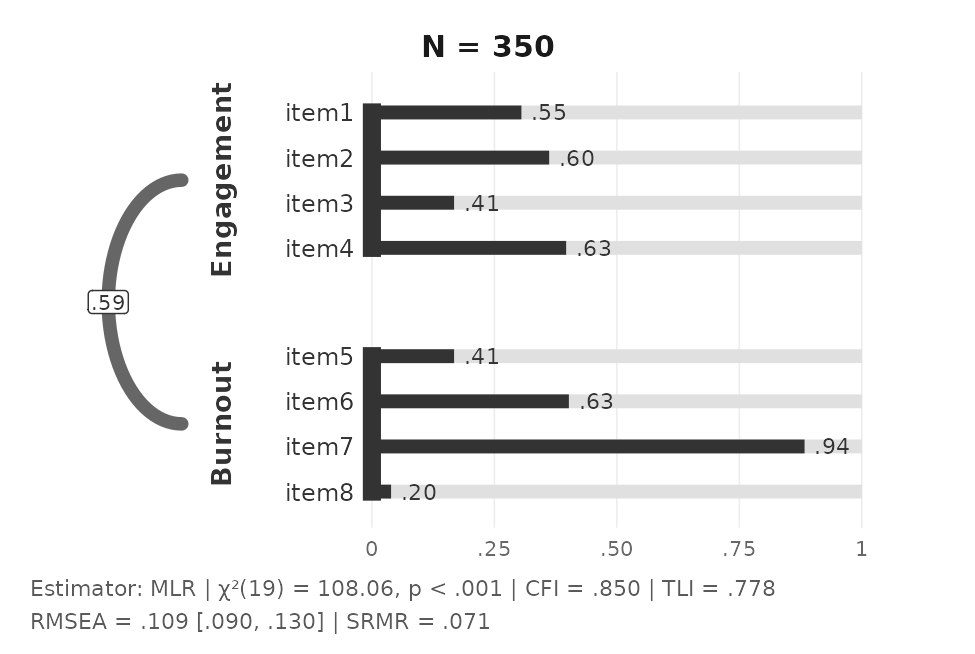
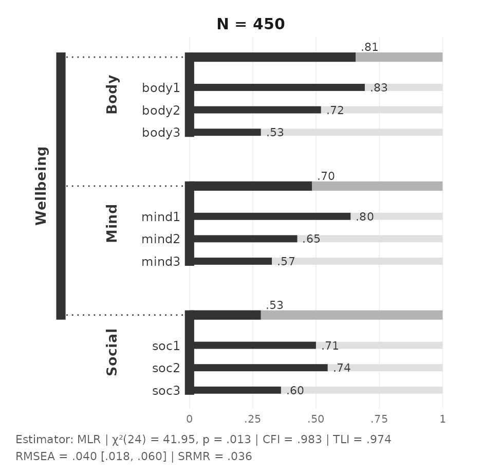
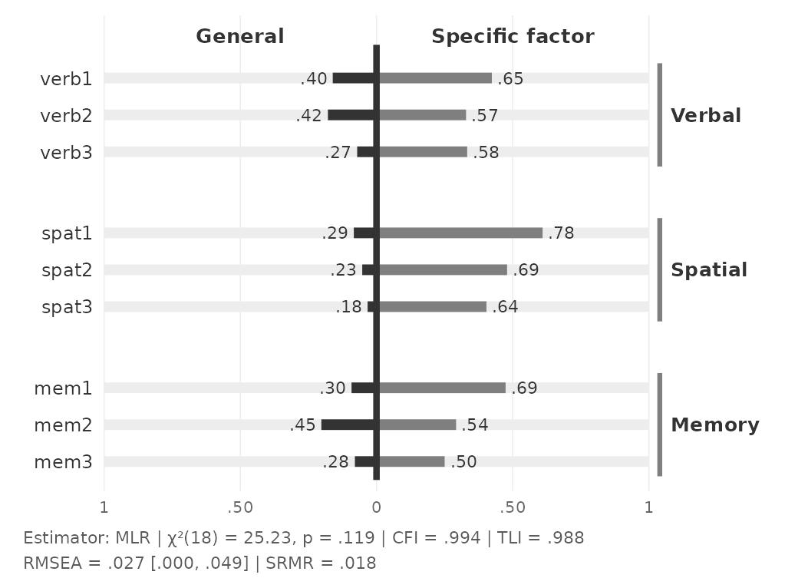
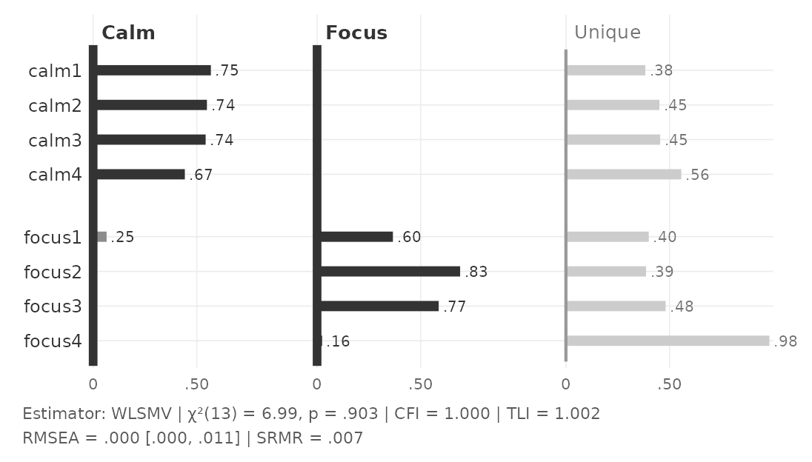

# Novel Visualizations in psyWiz: Visual Psychometrics Guide

Standard psychometric software often leaves researchers choosing between dense loading tables and cluttered "spaghetti" path diagrams where arrow lengths are layout artifacts rather than data.

**psyWiz** includes three purpose-built greyscale visualizations designed for factor analysis and structural equation modeling. Every figure is drawn on a common $0 \text{ to } 1$ variance scale, stays clean for export (no instructional captions baked into the image), pairs with a toggleable reading guide above the plot in jamovi, and optionally prints the model fit line with the estimator (`above` or `below`).

1. **The Comb Plot** (Single-Scale Check, CFA, Multi-Group CFA, and Second-Order Models)
2. **The Antenna Plot & Facing Combs** (Bifactor CFA)
3. **The Brush Plot** (CFA vs. ESEM)

---

## 1. The Comb Plot

### Visual Anatomy
* **Spine:** Each vertical spine represents a latent factor at 0.
* **Teeth (Variance Decomposition):** Each horizontal tooth spans an item's full variance ($0 \text{ to } 1$). The **dark segment** is the variance explained by the factor ($\lambda^2$, labeled with standardized $\lambda$); the **pale remainder** is unique/error variance ($1 - \lambda^2$).
* **Tooth Thickness (Optional):** Scales proportionally to each item's observed variance.
* **Arches:** Curves connecting factor spines show inter-factor correlations (thicker = stronger, shown up to 4 factors).
* **Brackets:** Brackets on the right connect item pairs whose residual correlation is freed in the model.
* **Second-Order Anchor:** In a second-order CFA, a left vertical spine connects to a top tooth on each first-order factor showing how much of that factor the higher-order construct explains.

### Examples (Fitted to Realistic Imperfect Data)

#### A. Decent Empirical CFA (`comb_cfa_good.png`)

* **What to look for:** Realistic, somewhat uneven survey loadings (`trust1`–`trust4` from `.44` to `.75`; `stress1`–`stress4` from `.52` to `.82`), moderate negative factor correlation ($r = -.29$), and solid overall fit despite minor real-world noise.
* **Fit Line:** `Estimator: MLR | χ²(19) = 47.28, p < .001 | CFI = .967 | TLI = .951 | RMSEA = .060 [.039, .082] | SRMR = .051`.

#### B. Problematic / Misfitting CFA (`comb_cfa_poor.png`)

* **What to look for:** Ragged, uneven teeth with weak stubs (`item3 = .41`, `item5 = .41`, `item8 = .20` leaving 96% unique variance), an inflated single item (`item7 = .94` driven by unmodeled shared wording), and poor global fit.
* **Fit Line:** `Estimator: MLR | χ²(19) = 108.06, p < .001 | CFI = .850 | TLI = .778 | RMSEA = .109 [.090, .130] | SRMR = .071`.

#### C. Second-Order CFA (`comb_cfa_second_order.png`)

* **What to look for:** `Wellbeing` anchors the left side, with dotted lines to the top tooth of each first-order factor (`Body = .81`, `Mind = .70`, `Social = .53`), showing immediately that `Social` retains substantially more domain-specific variance than `Body`.
* **Fit Line:** `Estimator: MLR | χ²(24) = 41.95, p = .013 | CFI = .983 | TLI = .974 | RMSEA = .040 [.018, .060] | SRMR = .036`.

---

## 2. The Antenna Plot (Bifactor CFA)

In a bifactor model, the key question is whether item variance is driven mostly by the broad **general factor** or by the **specific subscales**.

### Visual Anatomy
* **Central Mast:** Vertical line at zero explained variance.
* **Dark Left Bar:** Share of item variance explained by the general factor ($\lambda_g^2$, labeled with $\lambda_g$).
* **Grey Right Bar:** Share of item variance explained by its specific factor ($\lambda_s^2$, labeled with $\lambda_s$).

*(Bifactor CFA also offers **Facing Combs**, which places general variance from the left and specific variance from the right on one $0 \text{ to } 1$ bar so the pale middle gap directly displays unique variance.)*

### Examples

#### A. Mostly General Factor (`antenna_bifactor_general.png`)

* **What to look for:** Bars lean decisively left across `Somatic`, `Mood`, and `Sleep` ($\lambda_g \approx .55 - .77$), with only small, uneven specific loadings ($\lambda_s \approx .08 - .47$).
* **Takeaway:** A total `Distress` score captures most reliable common variance; subscale scores add limited independent information.
* **Fit Line:** `Estimator: MLR | χ²(18) = 24.31, p = .145 | CFI = .997 | TLI = .995 | RMSEA = .026 [.000, .049] | SRMR = .015`.

#### B. Mostly Specific Factors (`antenna_bifactor_specific.png`)

* **What to look for:** Bars lean strongly right across all three domains ($\lambda_s \approx .50 - .78$), while general loadings are modest ($\lambda_g \approx .18 - .45$).
* **Takeaway:** The subscales represent distinct constructs; collapsing them into a single total score would discard meaningful domain variance.
* **Fit Line:** `Estimator: MLR | χ²(18) = 25.23, p = .119 | CFI = .994 | TLI = .988 | RMSEA = .027 [.000, .049] | SRMR = .018`.

#### C. Mixed / Divergent Facets (`antenna_bifactor_mixed.png`)

* **What to look for:** Subscales behave differently: `Verbal` leans left (general-driven), `Spatial` leans clearly right (distinct specific factor, $\lambda_s = .50 - .70$), and `Memory` is split roughly evenly.
* **Takeaway:** Global indices alone hide facet-level differences; the Antenna plot exposes which subscales have genuine specific variance at a glance.
* **Fit Line:** `Estimator: MLR | χ²(18) = 37.47, p = .005 | CFI = .985 | TLI = .970 | RMSEA = .045 [.024, .065] | SRMR = .023`.

---

## 3. The Brush Plot (CFA vs. ESEM)

Exploratory Structural Equation Modeling (ESEM) with target rotation lets every item load on every factor while rotating non-target loadings toward zero. The Brush plot turns that loading matrix into an immediate visual check.

### Visual Anatomy
* **Vertical Handles:** One line per factor, plus a rightmost `Unique` column.
* **Bristles:** Horizontal bars showing squared standardized loadings ($\lambda^2$, labeled whenever $|\lambda| \ge .10$).
  * **Dark Bristles:** Target loadings on each item's hypothesized factor.
  * **Grey Bristles:** Cross-loadings on unintended factors.
* **Toothbrush Pattern:** A clean simple-structure factor looks like a toothbrush — strong dark bristles on its own items and a bare handle elsewhere.

### Examples

#### A. Clean "Toothbrush" ESEM (`brush_esem_good.png`)

* **What to look for:** Three clear toothbrushes (`Calm`, `Focus`, `Energy`) with solid target bristles ($\lambda = .53 - .87$) and virtually bare cross-loading handles (only one negligible `.10` blip on `foc3`).
* **Fit Line:** `Estimator: MLR | χ²(12) = 19.98, p = .068 | CFI = .992 | TLI = .975 | RMSEA = .038 [.000, .067] | SRMR = .018`.

#### B. Messy / Overlapping ESEM (`brush_esem_poor.png`)

* **What to look for:** Stray grey bristles sprouting across every handle (`calm2` loads `.53` on Energy; `ener2` loads `.71` on Calm; `foc1` has `.90` unique variance). Even when the unconstrained ESEM achieves decent global fit, the Brush plot immediately reveals that the hypothesized factor boundaries have collapsed.
* **Fit Line:** `Estimator: MLR | χ²(33) = 42.04, p = .135 | CFI = .993 | TLI = .985 | RMSEA = .025 [.000, .045] | SRMR = .022`.

#### C. Mixed ESEM with Specific Problems (`brush_esem_mixed.png`)

* **What to look for:** Fitted directly on the built-in `wizlab` dataset (`Calm` and `Focus`, ordinal `WLSMV`): `Calm` is a clean toothbrush (`.67`–`.75`), while on `Focus`, `focus1` shows a clear cross-loading onto `Calm` (`.25`) and `focus4` stands out immediately as a dud item (`.16` loading, `.98` unique variance).
* **Fit Line:** `Estimator: WLSMV | χ²(13) = 6.99, p = .903 | CFI = 1.000 | TLI = 1.002 | RMSEA = .000 [.000, .011] | SRMR = .007`.

---

## Plot Options in jamovi and R

* **Show plot guide** (`showPlotGuide`, default `TRUE`): Displays a short, collapsible reading guide *above* each novel plot in jamovi; untick for clean report output.
* **Model fit on plot** (`plotFit`: `none`, `below`, `above`; in R: `plot(x, fit = "below")`): Adds the estimator and fit indices cleanly without cluttering the figure with instructional text.
